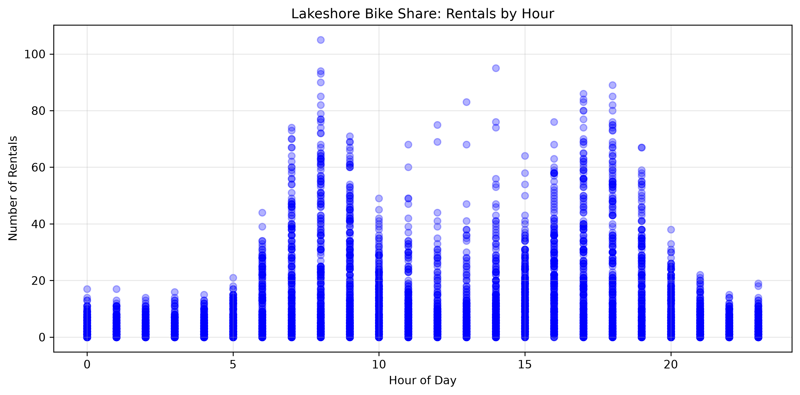
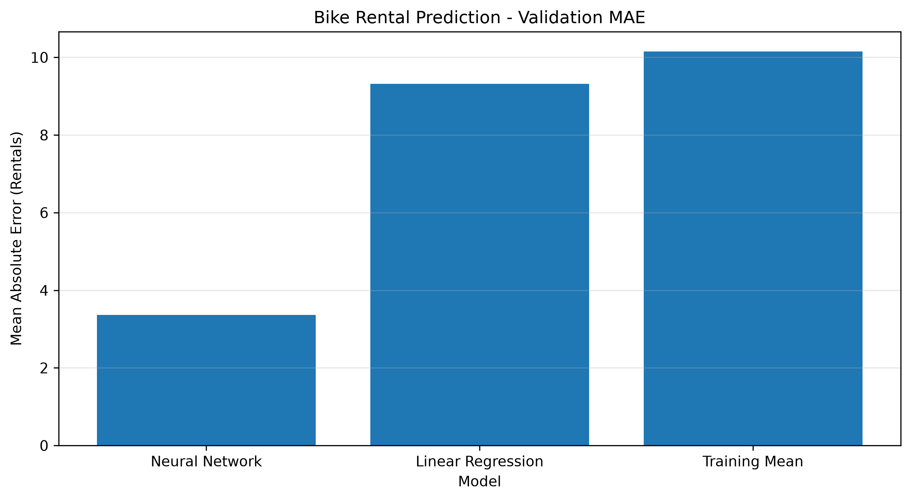
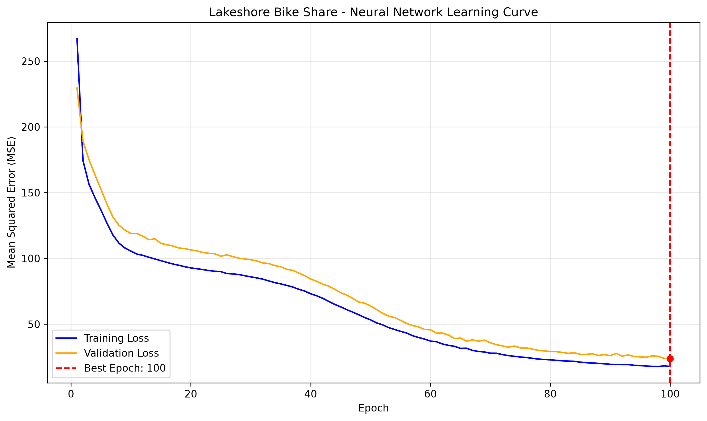
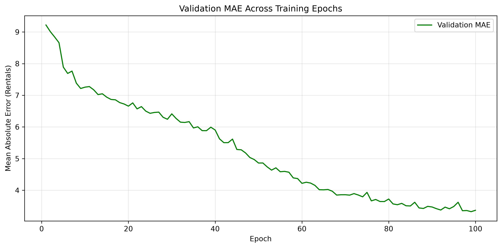

# lab7LBS

Lab 7 — Capstone Preparation, Humber College AIGC5005.

This project predicts hourly bike rentals for the synthetic Lakeshore Bike Share dataset using a PyTorch neural network. It compares the network with two simple baselines, tracks learning across epochs, and evaluates controlled hyperparameter experiments.

## Linear Relationship Assessment

The relationship between hour of day and bike rentals is nonlinear. Rental demand tends to peak during morning and evening commuting hours and decrease during quieter periods.

A straight-line model would not accurately capture these fluctuations. However, linear regression remains useful as a baseline for comparing the performance of more advanced nonlinear models.



## Data Preparation and Network Architecture

The dataset is generated by the instructor-provided `bikes_data.py` using `make_rentals()`; this file is kept unchanged. The 6,000 rows are split into training (60%), validation (20%), and held-out test (20%) sets with random seed 42. Preprocessing is fitted on the training data only: numeric features are standardized, and `station_type` is one-hot encoded.

The PyTorch model is an `nn.Module` with two ReLU hidden layers (64 and 32 neurons in the main run) and a single linear output neuron. No output activation is applied because the model predicts a rental count, not a probability. The output is a continuous estimate, so an occasional negative prediction is possible before any postprocessing.

## One-Epoch Training and Evaluation Function

A reusable `run_epoch()` function was implemented to support both training and evaluation of the PyTorch neural network.

When an optimizer is provided, the function enables training mode, calculates gradients using backpropagation, and updates the model weights.

When no optimizer is provided, the function switches to evaluation mode and disables gradient calculations, allowing performance to be measured without modifying model parameters.

The function returns the mean loss and Mean Absolute Error (MAE). MAE measures the average absolute difference between predicted and actual bike rentals, expressed in the original units of rentals.

Both metrics are aggregated across observations rather than averaged equally across batches.

## Multi-Epoch Neural Network Training

A `train_model()` function was implemented to train the neural network over multiple epochs using the Adam optimizer and Mean Squared Error (MSE) loss.

For every epoch, the function records the training loss, validation loss, and validation Mean Absolute Error (MAE).

Validation performance is monitored throughout training. Whenever the validation loss improves, a deep copy of the model's weights is saved.

After all epochs are completed, the weights corresponding to the lowest validation loss are restored. This ensures that the final model uses the best-performing epoch on the validation dataset rather than automatically using the last epoch.

Training and validation loss curves are plotted to assess model convergence and potential overfitting. Validation MAE is also plotted to measure prediction error in units of bike rentals.

The test dataset remains untouched during model training and selection.

## Baseline Model Comparison

Two baseline models were implemented to evaluate the effectiveness of the PyTorch neural network.

The first baseline predicts the mean rental count calculated exclusively from the training dataset. This provides a simple reference model that does not use individual input features.

The second baseline uses scikit-learn's `LinearRegression`, trained on the same preprocessed training features used by the neural network.

Both baselines are evaluated on the same validation observations as the neural network using Mean Absolute Error (MAE) and Mean Squared Error (MSE).

MAE represents the average prediction error in bike rentals, while MSE penalizes larger prediction errors more heavily.

The comparison helps determine whether the additional complexity of a neural network produces a meaningful improvement over simpler regression methods. The held-out test dataset remains untouched until final model evaluation.

The baseline results are saved in [`reports/baseline_comparison.csv`](reports/baseline_comparison.csv).



## Neural Network Learning Curve

The neural network was trained over multiple epochs, with training loss and validation loss recorded after every epoch.

The learning-curve plot illustrates how the model's prediction error changes during training. The dashed vertical line identifies the epoch with the lowest validation loss.

The model weights from this best epoch were restored after training to avoid retaining a later model with worse validation performance.





## Neural Network Experiment Comparison

Three configurations were trained for 100 epochs using the same split, preprocessing, loss function, optimizer type, and validation-selection rule. Each additional run changes **only one hyperparameter** relative to the main run.

| Run | Hidden Layers | Learning Rate | Best Epoch | Validation Loss (MSE) | Validation MAE (rentals) |
|---|---|---:|---:|---:|---:|
| Main | 64, 32 | 0.0010 | 100 | 23.2745 | 3.3687 |
| Lower Learning Rate | 64, 32 | 0.0005 | 100 | 76.8996 | 5.4230 |
| **Larger Hidden Layer** | **128, 32** | **0.0010** | **89** | **15.3439** | **2.6079** |

*Results shown are from the completed 100-epoch `python train.py` run. Earlier interactive notebook results may differ because training runs consumed random-number state in a different order.*

The **larger hidden layer** achieved the lowest validation loss and validation MAE. Its MAE was approximately **22.6% lower** than the main configuration (2.6079 versus 3.3687 rentals). Lowering the learning rate worsened performance over the fixed 100-epoch budget; both the main and lower-learning-rate runs had their best epoch at 100, so they may still have been improving when training ended. The larger network was selected using validation loss, not the held-out test set.

Detailed results are saved in [`reports/experiment_comparison.csv`](reports/experiment_comparison.csv), with per-epoch histories in `reports/history_*.csv`.

## Reproduce the Results

From the repository root, install the project dependencies in a suitable Python environment:

```bash
python -m pip install numpy pandas matplotlib scikit-learn torch pytest
```

Run the complete experiment:

```bash
python train.py
```

The script generates the data using `bikes_data.py`, applies the same train/validation/test split and preprocessing, evaluates both baselines, trains the three neural network configurations, restores each run's best validation weights, and writes CSV reports and PNG figures to `reports/`.

The full run consists of **three 100-epoch experiments**, so it can take several minutes. Fixed seeds improve reproducibility, but small numerical differences can occur across PyTorch versions, operating systems, and hardware. The README values above describe the verified run; if a new run differs, use the regenerated reports as the source of truth and update the table accordingly.

## Automated Tests

The `tests/test_train.py` suite contains **16 Pytest test cases**, including parametrized tests. The tests check:

- Deterministic dataset generation, expected columns, and valid rental counts.
- Correct 60/20/20 splitting and disjoint training, validation, and test rows.
- Preprocessing output dimensions and the network's single-output architecture for multiple hidden-layer configurations.
- Float32 tensors, dataset behavior, and DataLoader shuffling settings.
- Training updates versus evaluation without weight changes, and correct loss/MAE calculations.
- Restoration of the best validation-epoch weights.
- Baseline prediction behavior, empty-loader handling, and PNG figure creation.

Run all tests from the repository root:

```bash
python -m pytest -v
```

**Verified result: 16 passed.** The tests are designed to finish quickly without rerunning the complete 300-epoch experiment.

## Limitations

The dataset is synthetic, so the reported accuracy does not establish performance on real-world bike-share demand. The neural network predicts continuous values rather than enforcing nonnegative integers. The held-out test set has intentionally not been evaluated during model selection; final test performance should be reported only when the assignment calls for that final step.
