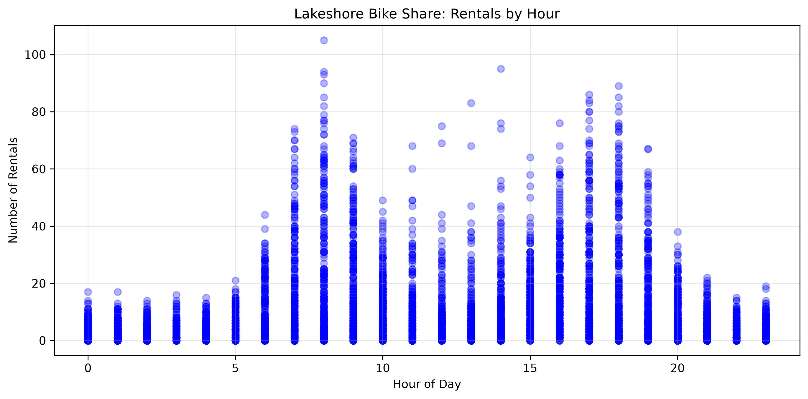
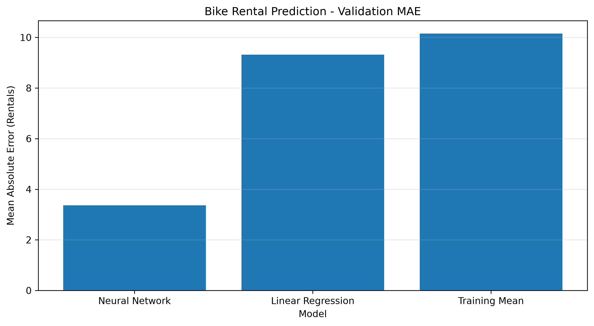
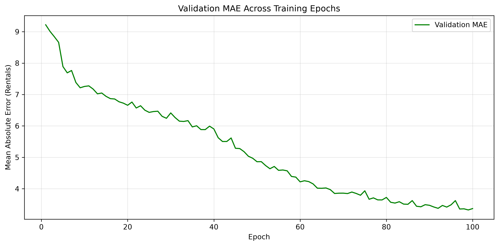

# Lakeshore Bike Demand prepared by Artemio Lobrin

**Lab 7 — Capstone Preparation | Humber College AIGC5005**

## What it does

This project predicts hourly bike rentals for the synthetic Lakeshore Bike Share dataset using a PyTorch neural network. It compares the network with training-mean and linear-regression baselines, tracks learning across epochs, and tests how learning rate and hidden-layer size affect validation performance.

## How to run it

From Anaconda Prompt, clone the repository and enter its folder:

```bash
git clone https://github.com/Arte8/lab7LBS.git
cd lab7LBS
```

Create and activate the supplied Conda environment:

```bash
conda env create -f environment.yml
conda activate lab7-lbs
```

Train the models and regenerate reports, then run the tests and lint check:

```bash
python train.py
python -m pytest -v
python -m ruff check .
```

The default training run performs **three experiments of 100 epochs each**. A short smoke test such as `python train.py --epochs 2` is not suitable for final reported results; rerun `python train.py` before submission if you use it. The environment includes Python 3.12, NumPy, pandas, matplotlib, scikit-learn, PyTorch, Pytest, and Ruff.

## Data and split

The instructor-provided `bikes_data.py` generates **6,000 synthetic observations** using `make_rentals()` (default generation seed **2026**). This file is kept unchanged. Inputs are `hour`, `temperature_c`, `rain_mm`, `wind_kph`, `is_weekend`, and `station_type`; the target is `rentals`.

The split uses seed **42** and assigns **60% (3,600 rows)** to training, **20% (1,200)** to validation, and **20% (1,200)** to the held-out test set. The subsets are disjoint. The numeric features are standardized using a scaler fitted **only on training rows**. `station_type` is one-hot encoded with categories learned from training data. The same fitted preprocessing is applied to validation and test data, preventing data leakage. The resulting model input has **eight features** (five numeric and three encoded station-type features). Dataset inputs and targets are converted to PyTorch `float32` tensors.

The relationship between hour and demand is nonlinear: morning and evening commuting periods can produce peaks that a straight line cannot represent well. Linear regression remains a useful comparison baseline.



## Model and training

`model.py` defines a feedforward `nn.Module` with **two ReLU hidden layers** and **one linear output**. The main configuration has **64 and 32 hidden neurons**; the larger experiment uses **128 and 32**. The linear output predicts a continuous rental count rather than a probability.

Training uses **mean squared error (MSE)** as the loss, the **Adam** optimizer, **32 observations per batch**, and reproducible shuffling of training batches using seed **42**. Validation and test batches are not shuffled. Each training batch clears previous gradients, performs backpropagation, and updates parameters. During validation, `run_epoch()` switches to evaluation mode and disables gradient calculation, leaving model weights unchanged. Both MSE and mean absolute error (MAE) are aggregated by observation rather than by unweighted batch averages; MAE is measured in rentals.

`train_model()` records training MSE, validation MSE, and validation MAE for each epoch. It saves a copy of the parameters whenever validation MSE improves and **restores the weights from the lowest-validation-MSE epoch** at the end. Hyperparameters and model selection use training and validation data only; the test set is reserved for final evaluation.

## Results

The training-mean baseline predicts the mean target value from the training set. The linear-regression baseline uses the same training-only-preprocessed inputs as the neural network. The table below compares these baselines with the **main 64/32 neural network** on the same validation observations, using values from `reports/baseline_comparison.csv`:

| Model | Validation MAE (rentals) | Validation MSE |
|---|---:|---:|
| Training Mean | 10.1539 | 222.3453 |
| Linear Regression | 9.3169 | 189.0908 |
| Neural Network — main (64, 32) | 3.3687 | 23.2746 |

The main neural network performs substantially better than either baseline on validation data. **The selected larger network** performs better still, with validation **MAE 2.6079** and **MSE 15.3439**; those numbers come from the experiment comparison below, not the main-run baseline CSV.



The learning curves show training and validation MSE over the epochs; the marked best epoch identifies the minimum validation MSE, whose weights are restored. Validation MAE shows the error in the original units of bike rentals. These plots should be examined for convergence and a growing training–validation gap, which can indicate overfitting.




The final held-out test evaluation occurs **once, after validation-based model selection**. The script saves test MAE and MSE for the selected network and both baselines in `reports/metrics.json`; test values are deliberately not used to choose the model. See that generated file for the exact final test metrics.

## Experiments

Three configurations were trained for **100 epochs** with the same split, preprocessing, MSE loss, Adam optimizer, batch size, and validation-selection rule. Each alternative changes **one hyperparameter** relative to the main run.

| Run | Hidden layers | Learning rate | Best epoch | Best validation MSE | Validation MAE (rentals) |
|---|---|---:|---:|---:|---:|
| Main | 64, 32 | 0.0010 | 100 | 23.2745 | 3.3687 |
| Lower learning rate | 64, 32 | 0.0005 | 100 | 76.8996 | 5.4230 |
| **Larger hidden layer** | **128, 32** | **0.0010** | **89** | **15.3439** | **2.6079** |

**Main:** The best validation epoch was 100, so further training might have improved the result. **Lower learning rate:** Worse validation results over the same 100-epoch budget suggest slower convergence; its best epoch was also 100. **Larger hidden layer:** Increasing the first hidden layer from 64 to 128 reduced validation MAE by approximately **22.6%** relative to the main run. Its best epoch was 89, and it was selected because it had the **lowest validation MSE**, without consulting the held-out test set.

Experiment results are saved to `reports/experiments.csv` and `reports/experiment_comparison.csv`, with per-run histories in `reports/history_*.csv` and the main history in `reports/history.csv`. The values above describe the recorded 100-epoch run; regenerate the reports with `python train.py` and update the table if a new environment produces different results.

## Limitations

The dataset is **synthetic**, so these validation and test results do not establish accuracy for real-world bike-share operations. The model uses only the supplied time, weather, weekend, and station-type variables; it does not account for holidays, special events, station capacity, service disruptions, or changes in rider behavior. Predictions are continuous and can occasionally be negative or non-integer, although rental counts cannot. The experiments cover only three configurations and a fixed 100-epoch budget, so they do not establish globally optimal hyperparameters. Finally, the held-out test set is evaluated only after model selection; the resulting metrics describe performance on this synthetic test split, not deployment performance.

### Automated tests and project outputs

The complete Pytest suite most recently reported **29 passed**. Tests cover deterministic generation and splits, training-only preprocessing, reproducible DataLoader shuffling, `float32` tensors, parametrized network output shapes, updates to all layers, gradient clearing and optimizer steps, small-batch memorization, evaluation without weight changes, and restoration of best-validation-epoch parameters.

Core files: `bikes_data.py` (instructor-provided and unchanged), `prepare.py` (split, preprocessing, datasets, loaders), `model.py` (network), and `train.py` (training, baselines, experiments, plots, and final test evaluation). Key outputs include `reports/history.csv`, `reports/experiments.csv`, `reports/learning_curves.png`, and `reports/metrics.json`.
