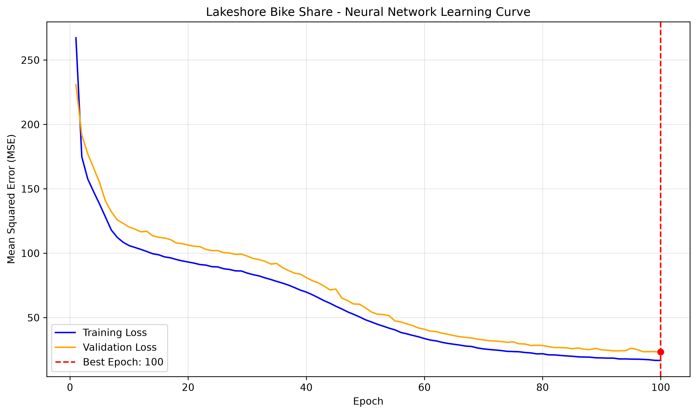

# Lakeshore Bike Demand prepared by Artemio Lobrin

**Lab 7 — Capstone Preparation | Humber College AIGC5005**

## What it does

This project predicts hourly bike rentals for the synthetic Lakeshore Bike Share dataset using a PyTorch neural network. It compares the network with training-mean and linear-regression baselines, tracks learning across epochs, and tests how learning rate and hidden-layer size affect validation performance.

## How to run it

From Anaconda Prompt, clone the repository and enter its folder:

```bash
git clone https://github.com/Arte8/lab7LBS.git
cd lab7LBS
```

Create and activate the supplied Conda environment:

```bash
conda env create -f environment.yml
conda activate lab7-lbs
```

Train the models and regenerate reports, then run the tests and lint check:

```bash
python train.py
python -m pytest -v
python -m ruff check .
```

The default training run performs **three experiments of 100 epochs each**. A short smoke test such as `python train.py --epochs 2` is not suitable for final reported results; rerun `python train.py` before submission if you use it. The environment includes Python 3.12, NumPy, pandas, matplotlib, scikit-learn, PyTorch, Pytest, and Ruff.

## Data and split

The instructor-provided `bikes_data.py` generates **6,000 synthetic observations** using `make_rentals()` (default generation seed **2026**). This file is kept unchanged. Inputs are `hour`, `temperature_c`, `rain_mm`, `wind_kph`, `is_weekend`, and `station_type`; the target is `rentals`.

The split uses seed **42** and assigns **60% (3,600 rows)** to training, **20% (1,200)** to validation, and **20% (1,200)** to the held-out test set. The subsets are disjoint. The numeric features are standardized using a scaler fitted **only on training rows**. `station_type` is one-hot encoded with categories learned from training data. The same fitted preprocessing is applied to validation and test data, preventing data leakage. The resulting model input has **eight features** (five numeric and three encoded station-type features). Dataset inputs and targets are converted to PyTorch `float32` tensors.

The relationship between hour and demand is nonlinear: morning and evening commuting periods can produce peaks that a straight line cannot represent well. Linear regression remains a useful comparison baseline.


## Model and training

`model.py` defines a feedforward `nn.Module` with **two ReLU hidden layers** and **one linear output**. The main configuration has **64 and 32 hidden neurons**; the larger experiment uses **128 and 32**. The linear output predicts a continuous rental count rather than a probability.

Training uses **mean squared error (MSE)** as the loss, the **Adam** optimizer, **32 observations per batch**, and reproducible shuffling of training batches using seed **42**. Validation and test batches are not shuffled. Each training batch clears previous gradients, performs backpropagation, and updates parameters. During validation, `run_epoch()` switches to evaluation mode and disables gradient calculation, leaving model weights unchanged. Both MSE and mean absolute error (MAE) are aggregated by observation rather than by unweighted batch averages; MAE is measured in rentals.

`train_model()` records training MSE, validation MSE, and validation MAE for each epoch. It saves a copy of the parameters whenever validation MSE improves and **restores the weights from the lowest-validation-MSE epoch** at the end. Hyperparameters and model selection use training and validation data only; the test set is reserved for final evaluation.

## Results

The training-mean baseline always predicts the average rental count in the training set. Linear regression fits a weighted combination of the preprocessed features. The neural network is the **selected larger-hidden-layer model (128, 32)**, chosen using validation MSE only. All three models must be evaluated on **the same validation rows and the same held-out test rows**. MAE is in **rentals**; MSE is in **rentals squared**.

| Model | Validation MAE (rentals) | Validation MSE (rentals²) | Test MAE (rentals) | Test MSE (rentals²) |
|---|---:|---:|---:|---:|
| Training mean | 10.1539 | 222.3453 | 9.6491 | 199.8228 |
| Linear regression | 9.3169 | 189.0908 | 8.5729 | 167.3763 |
| **Selected neural network (128, 32)** | **2.6079** | **15.3439** | **2.4903** | **13.6160** |

**Results provenance:** Values come from the completed 100-epoch run in `reports/metrics.json` (seed 42; 3,600 training, 1,200 validation, and 1,200 test observations). The `validation_baselines` entry for the neural network refers to the **main 64/32 configuration** (MAE 3.3687, MSE 23.2745). This table instead reports the **selected 128/32 configuration** using `selected_validation_mae` and `selected_validation_mse`, so the network results are internally consistent. The held-out test metrics were obtained after selecting the model by validation MSE.

Linear regression improves on the constant training-mean baseline on both validation and test rows, but performs substantially worse than the selected neural network. On the held-out test rows, the neural network reduces MAE by approximately **70.9%** compared with linear regression (2.4903 versus 8.5729 rentals). The rentals-by-hour scatterplot shows **nonlinear changes in demand, including peaks around commuting hours**; a linear model using the supplied features cannot represent those changing hourly patterns as flexibly as the ReLU network.




The learning curves plot **training MSE** and **validation MSE** across epochs. In the documented 100-epoch experiment, the main model's lowest validation MSE occurred at **epoch 100**, indicating it was still improving or had not achieved a lower validation loss earlier in that run. The dashed vertical marker identifies the epoch with the lowest validation MSE; its weights are restored after training. The gap between training and validation curves should be checked for signs of overfitting; the curves alone do not prove how well the model will perform on real bike-share systems. **Before submission, verify that the committed learning-curve PNG was regenerated by the full 100-epoch run**, rather than a two-epoch smoke test.


The validation MAE curve expresses typical prediction error in **rental counts**, which is easier to interpret operationally than MSE. The held-out test set was evaluated **after selecting the model using validation data**. Its MAE of **2.4903 rentals** and MSE of **13.6160 rentals²** are slightly lower than the selected model’s validation errors. Test metrics must not influence the choice of network or hyperparameters.

## Experiments

Three configurations were trained for **100 epochs** with the same split, preprocessing, MSE loss, Adam optimizer, batch size, and validation-selection rule. Each alternative changes **one hyperparameter** relative to the main run.

| Run | Hidden layers | Learning rate | Best epoch | Best validation MSE | Validation MAE (rentals) |
|---|---|---:|---:|---:|---:|
| Main | 64, 32 | 0.0010 | 100 | 23.2745 | 3.3687 |
| Lower learning rate | 64, 32 | 0.0005 | 100 | 76.8996 | 5.4230 |
| **Larger hidden layer** | **128, 32** | **0.0010** | **89** | **15.3439** | **2.6079** |

**Main:** The best validation epoch was 100, so further training might have improved the result. **Lower learning rate:** Worse validation results over the same 100-epoch budget suggest slower convergence; its best epoch was also 100. **Larger hidden layer:** Increasing the first hidden layer from 64 to 128 reduced validation MAE by approximately **22.6%** relative to the main run. Its best epoch was 89, and it was selected because it had the **lowest validation MSE**, without consulting the held-out test set.

Experiment results are saved to `reports/experiments.csv` and `reports/experiment_comparison.csv`, with per-run histories in `reports/history_*.csv` and the main history in `reports/history.csv`. The values above describe the recorded 100-epoch run; regenerate the reports with `python train.py` and update the table if a new environment produces different results.

## Limitations

**Who the data represent:** These are **6,000 simulated hourly bike-rental observations** produced by the instructor's `bikes_data.py`, not actual trips by identifiable riders or a verified sample of real Lakeshore Bike Share customers. The measured errors describe the synthetic generator's patterns and do not establish accuracy at real stations, in other cities, or in future seasons.

**What the model cannot see:** The input variables are hour, temperature, rainfall, wind, weekend status, and station type. The model has no information about public holidays, concerts and sporting events, school schedules, transit outages, road closures, station-specific inventory or capacity, broken bicycles, redistribution operations, pricing, long-term trends, or unexpected changes in rider behaviour. It does not model the availability of bikes and docks or provide uncertainty intervals. Its continuous output may be fractional or negative even though actual rental counts cannot be.

**What planners should not use it for:** A bike-share planner should **not use these predictions alone** to set staffing levels, purchase bicycles, relocate inventory, decide where to open or close stations, or make safety-critical or budget commitments. Such decisions require real operational data, station-level validation, uncertainty analysis, and human review. The model is suitable as an educational comparison of baseline regression and neural-network training, not as a production demand-forecasting system.

The experiments compare only three configurations for a fixed training budget. The test set was used for final evaluation after model selection; even a good held-out score on this synthetic split does not demonstrate real-world generalization.

### Automated tests and project outputs

The complete Pytest suite most recently reported **29 passed**. Tests cover deterministic generation and splits, training-only preprocessing, reproducible DataLoader shuffling, `float32` tensors, parametrized network output shapes, updates to all layers, gradient clearing and optimizer steps, small-batch memorization, evaluation without weight changes, and restoration of best-validation-epoch parameters.

Core files: `bikes_data.py` (instructor-provided and unchanged), `prepare.py` (split, preprocessing, datasets, loaders), `model.py` (network), and `train.py` (training, baselines, experiments, plots, and final test evaluation). Key outputs include `reports/history.csv`, `reports/experiments.csv`, `reports/learning_curves.png`, and `reports/metrics.json`.
****
